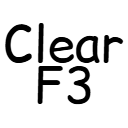

<p align="center">
  
</p>

<h1 align="center">Clear F3</h1>

<div align="center">

**English (Selected)** | [简体中文](docs/README_ZHCN.md)

</div>

<p align="center">
  <strong>A clearer view of your debug information.</strong><br>
  A grouped, customizable F3 overlay inspired by Minecraft 26.4.
</p>

<p align="center">
  <a href="https://fabricmc.net/"></a>
  <a href="https://neoforged.net/"></a>
  
  <a href="LICENSE"></a>
</p>

<div align="center">

[Installation](#installation) · [Quick Start](#quick-start) · [Configuration](#configuration) · [FAQ](#faq) · [Changelog](CHANGELOG.md) · [Development](docs/DEVELOPMENT.md)

</div>

---

Clear F3 organizes debug information into readable panels for position, memory, rendering, lighting, targeted objects, and more. Aligned labels and values make the screen easier to scan, while per-row colors let you highlight the information you use most.

The mod runs on the client and works in singleplayer and multiplayer. It uses the information available to your client and preserves the applicable vanilla debug options and restrictions.

## Features

| Feature | What you can do |
| --- | --- |
| **Grouped information** | Read position, memory, system specifications, rendering, lighting, heightmaps, spawning, sound, and target information in separate panels. |
| **Per-row colors** | Set each row's Key Color and Value Color independently, with resets for one color, one row, a group, or all colors. |

## Requirements

### Loaders and dependencies

| Dependency | Applies to | Requirement |
| --- | --- | --- |
| [Fabric Loader](https://fabricmc.net/use/installer/) | Fabric builds | `0.20.1` or newer, as declared by the current build configuration. |
| [Fabric API](https://modrinth.com/mod/fabric-api) | Fabric builds | Required; use a build matching your Minecraft version. |
| [NeoForge](https://neoforged.net/) | NeoForge builds | A compatible Minecraft 26.3 build; the current minimum is `26.3.0.26-beta`. |
| [Mod Menu](https://modrinth.com/mod/modmenu) | Fabric builds | Optional; adds a configuration entry in the mod list. |

**Install Clear F3 on the client.** A dedicated server does not need the mod.

### Minecraft and Java versions

The following targets are enabled in the current build configuration.

| Loader | Minecraft build targets | Minimum Java |
| --- | --- | --- |
| Fabric | `1.20.1`, `1.20.2`, `1.20.4` | 17 |
| Fabric | `1.20.6`, `1.21.1`, `1.21.3`, `1.21.4`, `1.21.5`, `1.21.8`, `1.21.10`, `1.21.11` | 21 |
| Fabric | `26.1.2`, `26.2`, `26.3` | 25 |
| NeoForge | `26.3` | 25 |


## Installation

1. Install **Fabric Loader** or **NeoForge** for your Minecraft version.
2. Choose the Clear F3 JAR for that loader and version.
3. Place it in your game instance's `mods` folder.
4. For Fabric, also install the matching **Fabric API**. Add **Mod Menu** if you want its configuration shortcut.
5. Launch Minecraft and enter a world or server.

## Quick Start

1. Press **F3** to display the debug overlay.
2. Press **F8** to switch between Clear F3 and vanilla F3.
3. Press **F9** to open Clear F3 settings.
4. Open **Row colors**, expand a group, and select a row's **Key Color** or **Value Color**.
5. Choose a preset or enter a hex color, check the preview, and click **Apply**.

These are the default bindings. You can change F8 and F9 in **General → Shortcuts**, or in **Options → Controls → Key Binds → Clear F3**. On macOS, your keyboard settings may require holding **Fn** to send function keys.

## Settings Pages

| Page | Purpose |
| --- | --- |
| **General** | Enable or disable Clear F3 and edit its two shortcuts. |
| **Row colors** | Browse collapsible groups and edit or reset individual row colors. |
| **Color editor** | Choose presets, enter a hex value, and preview a color before applying it. |

The main settings page has a translucent background. The color editor opens as an opaque light-gray dialog.

On Fabric, settings are also available through **Mod Menu → Clear F3 → Configure**. On NeoForge, use the mod list's configuration entry.

### Edit a shortcut

Click the button beside **Clear F3 Enable** or **Config Screen**, then press a keyboard key or mouse button. Press **Esc** while recording to clear the binding. Conflicting bindings appear in red.

Changes take effect immediately and are saved to Minecraft's `options.txt`, using the same bindings as the vanilla controls menu.

### Edit a row color

Each named row has separate **Key Color** and **Value Color** controls. Unnamed text rows expose the value control.

| Input | Meaning | Example |
| --- | --- | --- |
| `#RRGGBB` | An opaque RGB color | `#FFAA00` |
| `#AARRGGBB` | An ARGB color; the first two digits are opacity | `#80FFAA00` |

The preview shows the current draft. **Apply** saves it; **Cancel** or **Esc** discards it. Reset controls restore the default colors.

Some third-party or dynamic rows appear in settings after they have been collected by the debug overlay. Open F3 in the relevant context to discover them.

## Configuration

Clear F3 creates its configuration when the client initializes:

```text
<game-instance>/config/clear_f3/clear_f3.json
```

The settings belong to the game instance and are shared across its worlds and servers. Key bindings are stored separately in `<game-instance>/options.txt`.

A configuration with a custom position-row color looks like this:

```json
{
  "enabled": true,
  "colors": {
    "minecraft:position": {
      "clear_f3.row.xyz": {
        "key": "#FFFFAA00",
        "value": "#FF55FFFF"
      }
    }
  }
}
```

| Field | Meaning |
| --- | --- |
| `enabled` | `true` uses Clear F3; `false` uses the vanilla overlay. |
| `colors` | Color overrides organized by group ID and readable row ID. |
| `key` / `value` | The color of that row's label or value, saved as `#AARRGGBB`. |

Only custom overrides are saved. Missing entries use their default colors, so an empty `"colors": {}` object is normal. Row IDs such as `clear_f3.row.xyz` remain stable when the game language changes.

To edit the JSON manually, close the game, modify the file, and restart the client.

## FAQ

<details>
<summary><strong>Does the server need Clear F3?</strong></summary>

No. The overlay and configuration run on the client. Which measurements are available still depends on the game version and the information exposed by the world or server.

</details>

<details>
<summary><strong>Why is a row missing from the color settings?</strong></summary>

Some rows are discovered while the overlay collects information. Open F3 and look at the relevant block, fluid, entity, or other context, then check the group's settings again. Vanilla entry selection and reduced-debug restrictions can also affect which information is shown.

</details>

<details>
<summary><strong>Why does changing GUI Scale leave Clear F3 the same size?</strong></summary>

The debug overlay uses a fixed scale equivalent to GUI Scale 2. Menus, the hotbar, and vanilla charts keep their own scaling behavior.

</details>

## Acknowledgments

[Angelica PR #2301](https://github.com/GTNewHorizons/Angelica/pull/2301) for grouped debug presentation, and [Carpet-Igny-Addition](https://github.com/liuyuexiaoyu1/Carpet-Igny-Addition) for multi-version build organization.

Thanks to the maintainers of [Fabric](https://fabricmc.net/), [NeoForge](https://neoforged.net/), and [Mod Menu](https://modrinth.com/mod/modmenu). Shared multi-version sources use [ReplayMod Preprocessor](https://github.com/ReplayMod/preprocessor) and [Fallen-Breath's fork](https://github.com/Fallen-Breath/preprocessor).

Thank you to everyone who tests the mod, reports issues, and contributes code or translations.

## Feedback and Contributions

When reporting a problem, include the Minecraft version, loader and loader version, Clear F3 version, relevant mods or resource packs, and steps to reproduce it. Screenshots and relevant log excerpts help explain layout and compatibility problems.

For source contributions, see [Development notes](docs/DEVELOPMENT.md). User-visible changes should update both language providers and their generated language files.

## License

Clear F3 is available under [Apache License 2.0](LICENSE).
