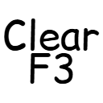

<p align="center">
  
</p>

<h1 align="center">Clear F3</h1>

<div align="center">

[English](../README.md) | **简体中文（当前）**

</div>

<p align="center">
  <strong>让调试信息更清晰。</strong><br>
  参考 Minecraft 26.4 设计，可自定义条目颜色的分组式 F3 界面。
</p>

<p align="center">
  <a href="https://fabricmc.net/"></a>
  <a href="https://neoforged.net/"></a>
  
  <a href="../LICENSE"></a>
</p>

<div align="center">

[安装](#安装) · [快速上手](#快速上手) · [配置文件](#配置文件) · [常见问题](#常见问题) · [更新记录](../CHANGELOG.md) · [开发文档](DEVELOPMENT.md)

</div>

---

Clear F3 将位置、内存、渲染、光照、目标对象等调试信息整理为独立面板。名称和值分别对齐，便于查找；每个条目都能单独设置颜色，突出你最关注的信息。

本模组在客户端运行，可用于单人游戏和多人服务器。显示内容来自客户端可获取的数据，并遵循对应版本的原版调试选项与信息限制。

## 功能

| 功能 | 可以做什么 |
| --- | --- |
| **分组显示** | 分别查看位置、内存、系统规格、渲染、光照、高度图、生物生成、声音和目标信息。 |
| **逐条配置颜色** | 分别设置每条信息的 Key Color 和 Value Color，可重置单个颜色、单行、整个分组或全部颜色。 |

## 运行要求

### 加载器与依赖

| 依赖 | 适用平台 | 要求 |
| --- | --- | --- |
| [Fabric Loader](https://fabricmc.net/use/installer/) | Fabric | 当前构建配置要求 `0.20.1` 或更新版本。 |
| [Fabric API](https://modrinth.com/mod/fabric-api) | Fabric | 必需，使用与 Minecraft 版本匹配的构建。 |
| [NeoForge](https://neoforged.net/) | NeoForge | 适用于 Minecraft 26.3 的兼容构建，当前最低版本为 `26.3.0.26-beta`。 |
| [Mod Menu](https://modrinth.com/mod/modmenu) | Fabric | 可选，提供模组列表中的配置界面入口。 |

**Clear F3 安装在客户端即可。** 独立服务器无需安装本模组。

### Minecraft 与 Java 版本

当前构建配置启用了以下目标版本。

| 加载器 | Minecraft 构建目标 | 最低 Java 版本 |
| --- | --- | --- |
| Fabric | `1.20.1`、`1.20.2`、`1.20.4` | 17 |
| Fabric | `1.20.6`、`1.21.1`、`1.21.3`、`1.21.4`、`1.21.5`、`1.21.8`、`1.21.10`、`1.21.11` | 21 |
| Fabric | `26.1.2`、`26.2`、`26.3` | 25 |
| NeoForge | `26.3` | 25 |

## 安装

1. 为你的 Minecraft 版本安装 **Fabric Loader** 或 **NeoForge**。
2. 选择与加载器及 Minecraft 版本对应的 Clear F3 JAR。
3. 将 JAR 放入当前游戏实例的 `mods` 文件夹。
4. 使用 Fabric 时，同时安装匹配版本的 **Fabric API**；需要模组菜单入口时，可安装 **Mod Menu**。
5. 启动 Minecraft，进入世界或服务器。

## 快速上手

1. 按 **F3** 显示调试界面。
2. 按 **F8** 在 Clear F3 与原版 F3 之间切换。
3. 按 **F9** 打开 Clear F3 设置。
4. 进入 **条目颜色**，展开分组，点击某一行的 **Key Color** 或 **Value Color**。
5. 选择预设或输入颜色，检查预览后点击 **应用**。

以上是默认按键。可以在 **常规 → 快捷键** 中直接修改 F8 和 F9，也可以通过 **选项 → 控制 → 按键绑定 → Clear F3** 修改。macOS 上可能需要根据键盘设置配合 **Fn** 使用功能键。

## 设置页面

| 页面 | 用途 |
| --- | --- |
| **常规** | 开启或关闭 Clear F3，并修改两个快捷键。 |
| **条目颜色** | 浏览可折叠分组，分别设置或重置每一行的颜色。 |
| **颜色编辑器** | 选择预设、输入十六进制颜色，在应用前预览效果。 |

Fabric 可以通过 **Mod Menu → Clear F3 → 配置** 打开设置；NeoForge 可以使用模组列表中的配置入口。

### 修改快捷键

点击 **启用 Clear F3** 或 **配置界面** 旁的按键按钮，再按下键盘键或鼠标键。录入时按 **Esc** 可清除绑定；与其他按键重复时显示为红色。

修改立即生效，并保存到 Minecraft 的 `options.txt`，与原版控制菜单使用同一组绑定。

### 修改条目颜色

每个具名条目分别提供 **Key Color** 和 **Value Color**。没有名称的纯文本条目使用 Value Color。

| 输入格式 | 含义 | 示例 |
| --- | --- | --- |
| `#RRGGBB` | 不透明的 RGB 颜色 | `#FFAA00` |
| `#AARRGGBB` | ARGB 颜色，前两位表示不透明度 | `#80FFAA00` |

预览显示当前草稿。点击 **应用** 后保存；**取消** 或 **Esc** 放弃草稿。重置操作恢复默认颜色。

部分第三方或动态条目会在调试界面采集到相关内容后出现在设置中。可先打开 F3，并进入对应的观察场景。

## 配置文件

客户端初始化时会创建配置：

```text
<游戏实例>/config/clear_f3/clear_f3.json
```

配置属于当前游戏实例，在该实例的各个世界和服务器之间共用。快捷键单独保存在 `<游戏实例>/options.txt` 中。

下面的示例修改了位置分组中坐标条目的颜色：

```json
{
  "enabled": true,
  "colors": {
    "minecraft:position": {
      "clear_f3.row.xyz": {
        "key": "#FFFFAA00",
        "value": "#FF55FFFF"
      }
    }
  }
}
```

| 字段 | 含义 |
| --- | --- |
| `enabled` | `true` 使用 Clear F3，`false` 使用原版调试界面。 |
| `colors` | 按分组 ID、可读条目 ID 组织的颜色覆盖。 |
| `key` / `value` | 该行名称或数值的颜色，保存格式为 `#AARRGGBB`。 |

文件只保存自定义的颜色，未设置的项目使用默认值。因此，`"colors": {}` 为空是正常情况。`clear_f3.row.xyz` 等条目 ID 不随游戏语言改变。

需要手动修改 JSON 时，请先关闭游戏，编辑后重新启动客户端。

## 常见问题

<details>
<summary><strong>服务器也需要安装 Clear F3 吗？</strong></summary>

不需要。调试界面和配置均在客户端运行。具体能显示哪些测量数据，仍取决于游戏版本以及世界或服务器提供的信息。

</details>

<details>
<summary><strong>为什么颜色配置中没有某个条目？</strong></summary>

部分条目需要在调试界面采集到内容后才能被发现。先打开 F3，观察相应的方块、流体、实体或其他场景，再查看分组设置。原版条目选择和简化调试信息限制也可能影响显示内容。

</details>

<details>
<summary><strong>为什么修改 GUI 缩放后，Clear F3 的大小没有变化？</strong></summary>

调试界面固定使用相当于 GUI Scale 2 的比例。菜单、物品栏和原版图表继续使用各自的缩放行为。

</details>

## 致谢

分组调试界面的展示思路参考了 [Angelica PR #2301](https://github.com/GTNewHorizons/Angelica/pull/2301)；多版本构建组织参考了 [Carpet-Igny-Addition](https://github.com/liuyuexiaoyu1/Carpet-Igny-Addition)。

感谢 [Fabric](https://fabricmc.net/)、[NeoForge](https://neoforged.net/) 和 [Mod Menu](https://modrinth.com/mod/modmenu) 的开发者与维护者。共享源码的多版本构建使用 [ReplayMod Preprocessor](https://github.com/ReplayMod/preprocessor) 和 [Fallen-Breath 的分支](https://github.com/Fallen-Breath/preprocessor)。

也感谢每一位参与测试、反馈问题以及贡献代码和翻译的朋友。

## 反馈与贡献

反馈问题时，请提供 Minecraft 版本、加载器及其版本、Clear F3 版本、相关模组或资源包，以及复现步骤。界面与兼容性问题可以附上截图和相关日志片段。

代码贡献请参考 [开发文档](DEVELOPMENT.md)。涉及界面文案的修改，需要同步更新中英文语言提供者和生成的语言文件。

## 许可证

Clear F3 使用 [Apache License 2.0](../LICENSE)。
